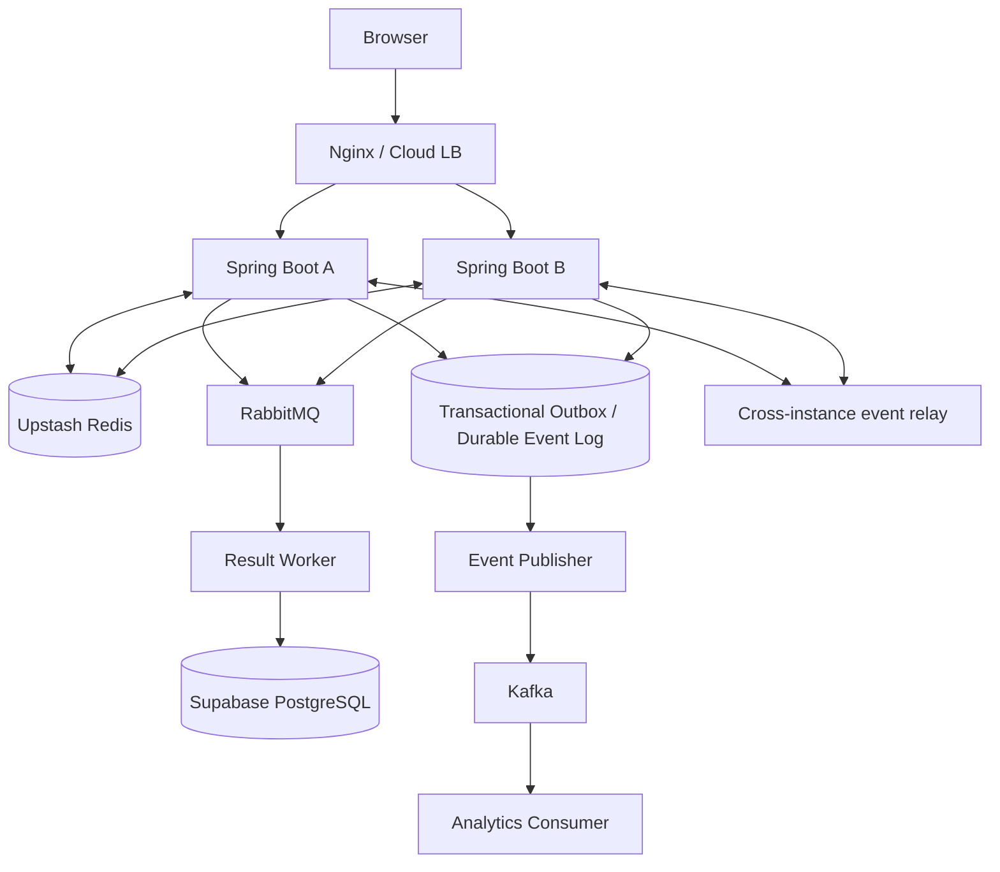

# 시스템 아키텍처 및 데이터 흐름
## 1. 논리 구성

주의: 이 그림은 목표 논리 구조. 실시간 전달의 원자적 상태 갱신과 Kafka 발행을 단순 이중 쓰기하면 유실 창이 생긴다. 이벤트 로그/Outbox 설계를 아래와 같이 별도로 검증한다.

## 2. 폭탄 전달 시퀀스
1. 클라이언트가 commandId, roomId, expectedRoundVersion을 포함한 전달 명령 전송.
2. 인증/방 참가 검증 후 Redis Lua에서 서버 시간 기준으로 폭발 시각, 현재 소유자, 쿨타임, 중복 commandId 검사.
3. Lua가 소유자와 상태 버전을 한 번에 변경하고 이벤트를 Redis Stream에 기록(같은 Redis 원자 실행 내).
4. 명령 응답에 상태 버전 포함. 서버 간 릴레이는 Stream 소비 또는 Pub/Sub 알림+Stream 재조회로 다른 서버에 이벤트 전달.
5. 각 Spring Boot 인스턴스는 자신이 보유한 WebSocket 세션에만 상태 변경을 전파.
6. 별도 퍼블리셔가 Stream 이벤트를 Kafka에 전달. Kafka 전송 후 체크포인트 갱신, 중복 발행 가능하므로 eventId 멱등 처리.

## 3. 폭발 시퀀스
- 서버 측 타이머는 단일 리더 또는 다중 워커의 경쟁 실행을 허용하되, 최종 폭발은 Redis Lua의 상태 버전 조건으로 단 한 번 확정.
- 만료 시각이 지난 폭탄은 전달 명령에서도 먼저 폭발 처리하거나 별도 타이머 워커가 처리하도록 설계해 경계 조건 누락 방지.
- 폭발 이벤트를 기록하고 탈락자 갱신, 새 라운드 생성 또는 게임 종료.

## 4. 게임 종료 시퀀스
- Redis에서 FINISHED 상태와 결과 이벤트 기록.
- 결과 저장 작업을 RabbitMQ로 전달. 브로커 발행 실패 복구를 위해 Redis Stream 기반 전달 워커 또는 영속 Outbox가 필요.
- Worker는 Supabase PostgreSQL 트랜잭션으로 game_result, participants, reward_ledger 등을 멱등 upsert/insert.
- ACK는 DB 커밋 후 전송. 실패 시 재시도, 최대 횟수 초과 시 DLQ.

## 5. 일관성 및 장애
- Redis는 진행 중 게임의 권위 있는 상태 저장소지만 영구 내구성 보장은 별도 구성에 의존. Upstash 관리형 서비스의 내구성/보존 정책을 확인하고 장애 시 경기 취소/복구 정책 결정 필요.
- Redis Stream과 Kafka 사이, RabbitMQ와 Supabase PostgreSQL 사이의 전달은 at-least-once를 전제로 소비자 멱등성 확보.
- Kafka를 넣는 것만으로 Redis 유실 복구가 자동 제공되지는 않음. 이벤트 누락 탐지 및 스냅샷 복원 절차 필요.
- 두 앱 인스턴스는 메모리 상태를 권위 있는 데이터로 사용하지 않음.
- WebSocket 브로드캐스트는 다중 서버에서 별도 relay가 필요. 단순 Spring in-memory broker는 인스턴스 간 공유되지 않음.
