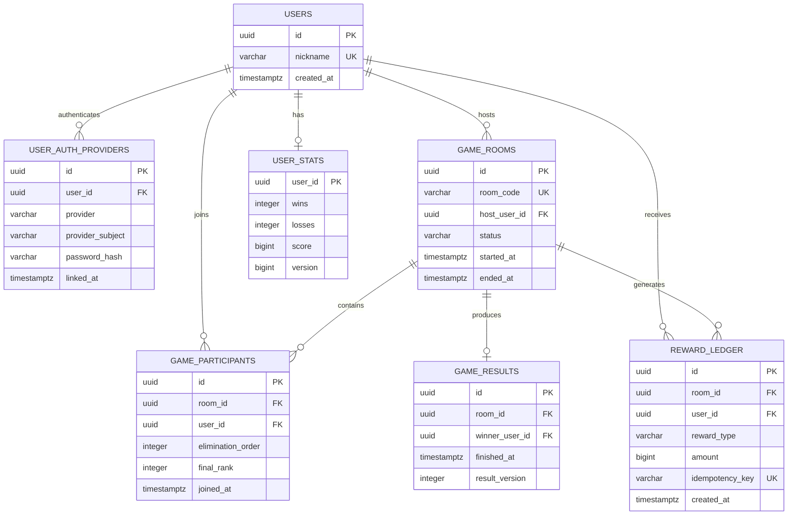

# Supabase PostgreSQL ERD 및 스키마 설계

## 1. ERD

## 2. 인증 모델
- Spring Security가 인증의 주체이며 Supabase는 **관리형 PostgreSQL DB**로 사용한다. Supabase Auth와 중복으로 인증 체계를 운영하지 않는다(변경 시 별도 ADR).
- `users`: 서비스 내부 회원 식별자(UUID), 닉네임, 가입 시각.
- `user_auth_providers`: `provider` = LOCAL / GOOGLE / KAKAO, `provider_subject`는 제공자 고유 ID 또는 LOCAL 이메일의 정규화된 값. `UNIQUE(provider, provider_subject)`.
- LOCAL은 `password_hash`에 Argon2id/BCrypt 해시 저장, 소셜 계정은 NULL. 원문 비밀번호 저장 금지.
- 동일 이메일이라는 이유만으로 서로 다른 소셜 계정을 자동 연결하지 않는다. 로그인된 사용자에게 명시적 계정 연결 절차 제공.
- 로그인 세션/Refresh Token은 별도 보안 정책에 따라 관리하고 계정 연결·해제는 감사 로그 대상.

## 3. PostgreSQL 제약 및 인덱스
- UUID PK: `gen_random_uuid()` 사용 가능. `timestamptz`, `jsonb`, `CHECK` 등 PostgreSQL 타입 사용.
- `game_rooms.room_code` UNIQUE, `host_user_id` FK. 상태는 CHECK 제약 또는 PostgreSQL ENUM.
- `game_participants UNIQUE(room_id, user_id)`, `INDEX(user_id, room_id)`.
- `game_results UNIQUE(room_id)`; winner가 참가자인지 트랜잭션/서비스 검증.
- `reward_ledger UNIQUE(idempotency_key)`; 예: `game:{roomId}:winner:{userId}:reward:{type}`.
- `user_stats.user_id` PK/FK; `version` 낙관적 잠금 선택 가능.
- 중복 결과 저장 방지: PostgreSQL `INSERT ... ON CONFLICT DO NOTHING/UPDATE` 사용. MySQL `INSERT IGNORE` 사용하지 않음.
- JPA `ddl-auto=validate`, Flyway로 마이그레이션. Supabase 연결 풀/동시 접속 제한을 고려해 HikariCP 크기 설정.

## 4. 저장 원칙
- Supabase PostgreSQL: 회원/계정 연결/방 메타데이터/참가 이력/경기 결과/보상/통계 영속화.
- Upstash Redis: 진행 중 게임 상태/소유권/쿨타임/연결 상태. 매 클릭을 PostgreSQL에 동기 저장하지 않음.
- 이벤트 아카이브와 Outbox는 필요 시 PostgreSQL `jsonb`로 확장. 이벤트 발행·DB 저장 간 원자성은 별도 릴레이로 보완.
- Supabase 무료 프로젝트의 일시 중지, 저장 용량, 백업/복구 범위는 실제 요금제 정책 확인 필요.
