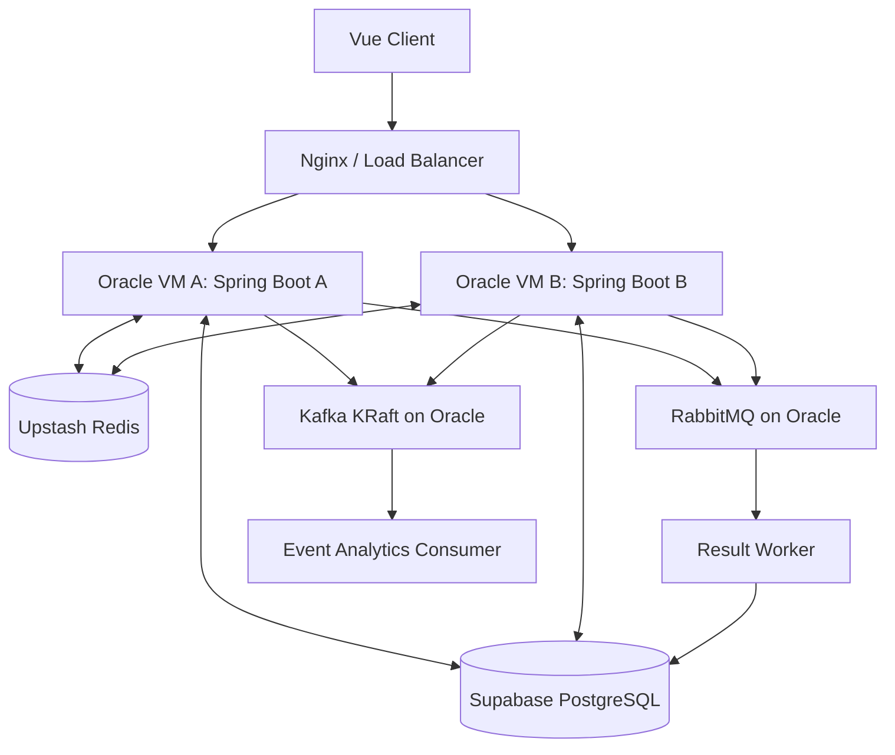

# 인프라·배포 설계 — Oracle + Supabase + Upstash

## 1. 목표 및 운영 경계
- **Oracle Cloud ARM Always Free**: Spring Boot 2개 인스턴스, Nginx/로드밸런서, RabbitMQ, Kafka를 실제 운영.
- **Supabase PostgreSQL**: 외부 관리형 영구 DB. Oracle에서 MySQL 운영하지 않음.
- **Upstash Redis**: 외부 관리형 게임 상태 저장소. Oracle에서 Redis 운영하지 않음.
- 클라우드의 무료 할당량·가용 리전·인스턴스 재고·스토리지/네트워크·서비스 정책은 생성 시 공식 콘솔 확인.

## 2. 개념 토폴로지

- VM 배치 예시: VM A에 Spring A + Nginx + RabbitMQ, VM B에 Spring B + Kafka. 실제 메모리·CPU 사용량을 측정해 조정.
- RabbitMQ/Kafka를 VM 1대에 각각 단일 노드로 운영하면 해당 VM이 단일 장애점. 운영형 HA 클러스터라고 주장하지 않음.
- Supabase와 Upstash는 VM 외부의 관리형 서비스이므로 TLS 연결, 비밀 정보 관리, 리전 간 RTT 측정 필요.

## 3. 개발/배포 단계
1. 로컬 Docker Compose: Spring 2, Nginx, RabbitMQ, Kafka. Supabase/Upstash는 개발용 프로젝트 또는 별도 테스트 인스턴스에 연결.
2. Oracle VM 1대에서 앱 다중 컨테이너와 브로커를 시험해 자원 사용량 측정.
3. 무료 ARM 할당량 내 VM 2대로 분리(가능할 경우), LB/WS 재연결/상태 공유 검증.
4. RabbitMQ와 Kafka **둘 다 Oracle 서버에 배포**. 자원 부족 시 로컬 전용으로 전환하는 대신 기능·리소스 사용량·배치 최적화 또는 추가 인프라 비용 여부를 재검토.

## 4. 로드밸런싱과 Blue/Green
- LB: HTTP 라운드로빈/헬스체크. WebSocket 업그레이드 지원; 기존 WS 연결은 해당 앱 인스턴스에 유지됨.
- 여러 앱 서버에 분산된 WS 세션은 공유 Redis의 이벤트 Stream/릴레이를 통해 각 서버가 자체 구독자에게 전달. 스냅샷 버전으로 재접속 복구.
- Blue/Green: 새 이미지 기동→DB 호환성/헬스체크→신규 트래픽 전환→기존 WS 드레이닝·재접속→모니터링→이전 버전 종료.
- 두 VM을 나눠도 **총 무료 OCPU/RAM은 늘지 않음**. 독립 VM 장애 격리와 네트워크 구성을 실험하는 것.
- 2개 활성 앱 + 2개 Green 앱을 동시에 띄우는 배포는 자원 부담이 큼. 일시적 단일 Green 전환 등 축소형 Blue/Green은 실험 제약을 명시.

## 5. 보안/운영
- RabbitMQ 관리 포트·Kafka 브로커 포트 외부 공개 금지. VM 내부/프라이빗 네트워크 또는 인증·TLS 설정.
- Supabase DB 접속정보와 Upstash 토큰은 GitHub Secrets/서버 비밀 관리. 브라우저에 DB 비밀번호·Redis 토큰 노출 금지.
- Supabase 연결 풀(HikariCP) 총합, DB 유휴 중지 정책, Upstash 요청 한도/스크립트 지원, Kafka 디스크 사용량을 모니터링.
- Oracle ARM64 호환 컨테이너 이미지와 Kafka KRaft 단일 브로커 구성을 검증.
